<a href="https://niklasdgl.github.io/">
  <picture>
    <source media="(prefers-color-scheme: dark)" srcset="assets/header-dark.svg" />
    
  </picture>
</a>

  
  
  

### `$ ls ~/stack`

<picture>
  <source media="(prefers-color-scheme: dark)" srcset="https://skillicons.dev/icons?i=py,cpp,cs,c,java,julia,r,postgres,pytorch,git,docker,linux&theme=dark&perline=12" />
  
</picture>

### `$ git log --graph`

<picture>
  <source media="(prefers-color-scheme: dark)" srcset="https://raw.githubusercontent.com/niklasdgl/niklasdgl/output/github-snake-dark.svg" />
  
</picture>
